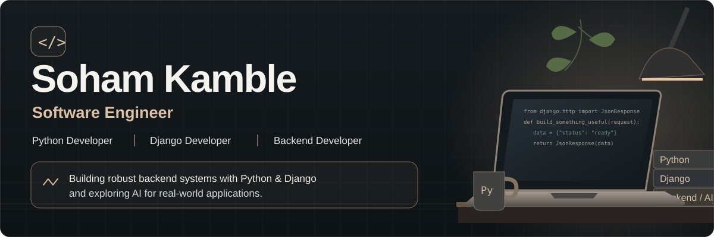

# Soham Kamble

<picture>
  <source media="(prefers-reduced-motion: reduce)" srcset="assets/soham-hero-static.svg">
  
</picture>

I build Python backends with Django, from a marketplace with payment integration to a multi-room chat app. I’m deepening my skills in data structures and algorithms and exploring how to apply AI to the software I build.

## Education & certifications

- **B.E. in Computer Engineering**, B R Harne College of Engineering & Technology · **CGPA 7.75/10** · July 2025
- Ranked among the top three students across all semesters, as listed on my résumé.
- **CS50’s Introduction to Programming with Python** and **CS50’s Introduction to Computer Science** · Harvard University via edX, 2024
- **Django Masterclass: Build 9 Real-World Projects** · Udemy, 2025

## Selected projects

### Multi-Vendor Digital Marketplace

Built a marketplace API with Django REST Framework and JWT authentication. Integrated Razorpay payments and built a seller analytics dashboard with Chart.js.

[View repository](https://github.com/Soham-Kamble/Multi-Vendor-Digital-Marketplace)

### Real-Time Chat Application

Built multi-room messaging with Django Channels and WebSockets, with PostgreSQL for room and message history.

[View repository](https://github.com/Soham-Kamble/Real-Time-Chat-Application)

### Advanced Expense Tracker

Built a Django app for logging and categorizing expenses, with Chart.js views for category breakdowns and daily spending trends.

[View repository](https://github.com/Soham-Kamble/Advanced-Expense-Tracker)

## Skills

- **Backend** · Python, Django, Django REST Framework, Django Channels, REST APIs, WebSockets, JWT
- **Data** · SQL, PostgreSQL, SQLite
- **Frontend** · JavaScript, HTML5, CSS3, Tailwind CSS, Chart.js
- **Tools & deployment** · Git, GitHub, Postman, Render

## GitHub contributions

Public GitHub contribution snapshot · 16 Nov 2025 to 20 Nov 2026. [View the live calendar](https://github.com/Soham-Kamble?tab=overview).

## Profiles

[GitHub](https://github.com/Soham-Kamble) · [LeetCode](https://leetcode.com/u/SohamKamble/) · [LinkedIn](https://www.linkedin.com/in/soham-kamble/)

<picture>
  <source media="(prefers-reduced-motion: reduce)" srcset="assets/soham-footer-static.svg">
  
</picture>
