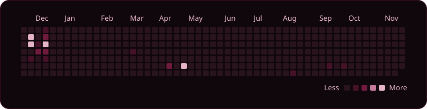

<picture>
  <source media="(prefers-reduced-motion: reduce)" srcset="assets/soham-hero-static.svg">
  
</picture>

 

### I turn ideas into working software — from APIs and payments to real-time experiences.

**Python & Django Developer** · **Backend Engineering** · **Exploring AI**

  
  
  

Clean architecture. Useful products. Constant improvement.

---

## 👋 A little about me

I'm **Soham**, a Computer Engineering graduate who enjoys building the systems that make products work.

I work primarily with **Python, Django, and Django REST Framework**. I have built a multi-vendor marketplace with payment processing, a multi-room chat application, and an expense tracker with interactive analytics. Alongside backend development, I'm strengthening my **data structures and algorithms** fundamentals and learning how to bring **AI** into practical applications.

> My favorite kind of project is one where there's a real problem to solve, an interesting system to design, and something useful to ship.

## ✦ Featured work

<table>
<tr>
<td width="50%" valign="top">

### 🛍️ Multi-Vendor Digital Marketplace

**Commerce, payments & APIs**

A digital-product marketplace with JWT-protected endpoints, buyer and seller workflows, **Razorpay payments**, and a sales dashboard.

`Django` `DRF` `PostgreSQL` `Razorpay` `Chart.js`

**[Explore code →](https://github.com/Soham-Kamble/Multi-Vendor-Digital-Marketplace)** · **[Live demo ↗](https://multi-vendor-digital-marketplace.onrender.com)**

</td>
<td width="50%" valign="top">

### 💬 Real-Time Chat Application

**Multi-room messaging**

A Django chat experience with authentication, chat rooms, a responsive interface, and an ASGI-based setup for real-time communication.

`Python` `Django` `Django Channels` `WebSockets` `Tailwind CSS`

**[Explore code →](https://github.com/Soham-Kamble/Real-Time-Chat-Application)**

</td>
</tr>
<tr>
<td width="50%" valign="top">

### 📊 Advanced Expense Tracker

**Personal finance & visualization**

Track expenses, organize spending by category, and visualize patterns through interactive charts and date-range summaries.

`Django` `SQLite` `Tailwind CSS` `Chart.js`

**[Explore code →](https://github.com/Soham-Kamble/Advanced-Expense-Tracker)**

</td>
<td width="50%" valign="top">

### 🧠 What I'm exploring next

**The intersection of software & intelligence**

Sharpening DSA and problem-solving skills while exploring how AI can enhance useful, dependable software.

**Currently focused on:** Python fundamentals, backend engineering, algorithms, and applied AI.

**[Follow my progress →](https://github.com/Soham-Kamble?tab=repositories)**

</td>
</tr>
</table>

## ⚙️ My toolkit

**Backend & APIs**

`Django REST Framework` · `Django Channels` · `REST APIs` · `WebSockets` · `JWT`

**Frontend & data visualization**

`Chart.js`

**Workflow & deployment**

`Render` · `SQL`

## 📈 The work behind the work

Contribution snapshot: 16 Nov 2025 – 20 Nov 2026 · <a href="https://github.com/Soham-Kamble?tab=overview">See my live GitHub activity</a>

## 🎓 Beyond the code

- **B.E. in Computer Engineering** — B R Harne College of Engineering & Technology · **7.75/10 CGPA** · 2025
- **Harvard CS50 via edX** — Introduction to Computer Science & Introduction to Programming with Python · 2024
- **Django Masterclass** — Build 9 Real-World Projects · Udemy · 2025

<b>More about my learning journey</b>

 

During my degree, I ranked among the top three students across semesters, as noted on my résumé. I continue learning through building projects, studying computer science fundamentals, and experimenting with new ideas.

---

### Have an interesting idea or opportunity?

I'm always happy to connect with people building thoughtful software.

**[LinkedIn](https://www.linkedin.com/in/soham-kamble/)** · **[GitHub](https://github.com/Soham-Kamble)** · **[LeetCode](https://leetcode.com/u/SohamKamble/)**

 

<picture>
  <source media="(prefers-reduced-motion: reduce)" srcset="assets/soham-footer-static.svg">
  
</picture>

Built with curiosity, Python, and a commitment to getting better.

